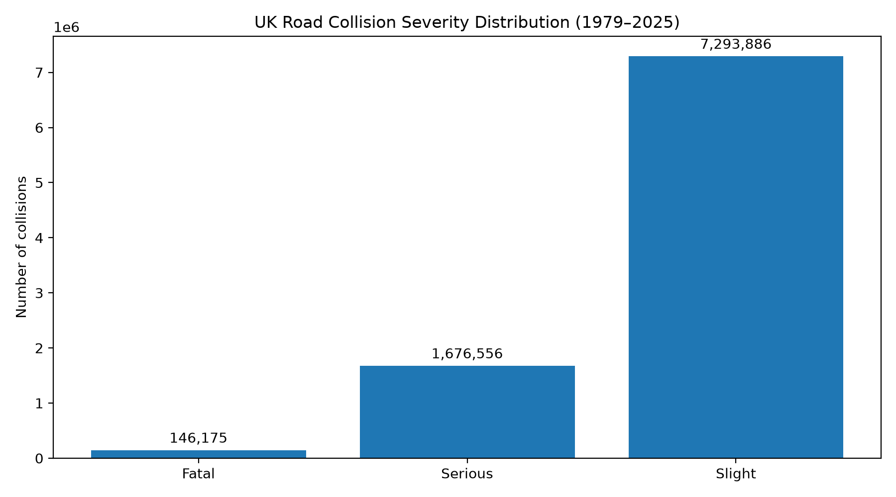
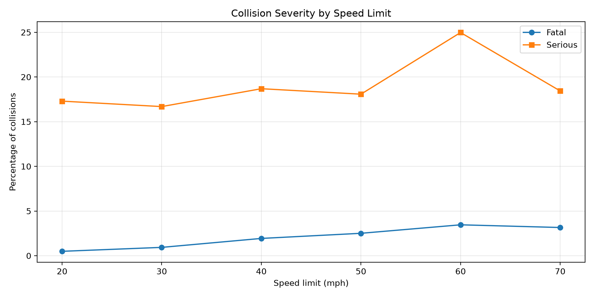
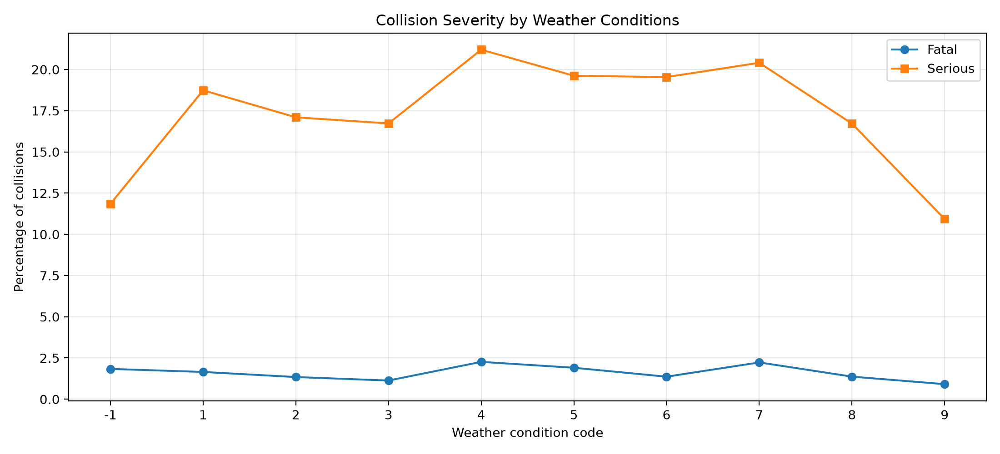

# Predicting Road Accident Severity in the UK

**DSAI3202 — Phase 1**  
**Student:** Abdulrahman Abuhashim  
**Student ID:** 60301190

## 1. Project and Hypothesis

My project aims to predict road accident severity in the UK using machine learning.

The target is `collision_severity`:
- 1 = Fatal
- 2 = Serious
- 3 = Slight

**Hypothesis:** Using road, weather, time, and location information, a machine-learning model can predict road accident severity better than a simple logistic regression model.

**Baseline model:** Logistic Regression  
**Comparison model:** Gradient-Boosted Trees  
**Evaluation metric:** Macro F1-score

Macro F1-score is chosen because the severity classes are imbalanced.

No changes to the hypothesis were documented during Phase 1. Model training will be done in the next phase.

## 2. Dataset and Architecture

### Dataset

- **Source:** UK Department for Transport
- **Dataset:** Road Safety Open Data — Collisions
- **Years:** 1979–2025
- **Format:** CSV
- **Size:** 1,534,937,928 bytes (approximately 1.53 GB)
- **Records:** 9,116,625
- **Columns:** 44
- **Ingestion:** Batch
- **Source version:** `source_v1`
- **Processed version:** `processed_v1`

Dataset link:  
https://www.gov.uk/government/statistical-data-sets/road-accidents-and-safety-statistics-data-tables

### Azure Architecture

```text
UK Department for Transport
           |
           v
      Original CSV
           |
           v
   Azure Blob Storage
     Raw Container
           |
           v
    Azure Linux VM
    Python ETL Pipeline
  Cleaning and Validation
           |
           v
    Processed Parquet
           |
           v
   Azure Blob Storage
   Processed Container
           |
      +----+----+
      |         |
      v         v
     EDA     Initial Features
```

Azure Blob Storage stores the datasets and metadata. The Azure VM runs the Python ETL, quality checks, EDA, and feature engineering.

### Storage Layout

**Storage account:** `amazonlake60301190`

Raw data:
`raw/projects/road-accident-severity/source_v1/`

Processed data:
`processed/projects/road-accident-severity/processed_v1/`

Metadata:
`processed/metadata/road_accident_metadata.json`

The original CSV is preserved in a versioned folder with a manifest containing its identity and SHA-256 hash.

The ingestion uses a fixed dataset snapshot. Future updates should use a new version.

A repeated upload with overwrite protection returned `BlobAlreadyExists`, confirming that the original file was not overwritten.

### Schema and Lineage

- [Schema — 44 columns](config/schema_v1.json)
- [Feature specification](config/features_v1.md)

**Primary key:** `collision_index`  
**Target:** `collision_severity`

Data lineage:

Original CSV → Azure raw storage → Python ETL → Azure processed Parquet files.

The Azure metadata JSON records the source, processing results, important fields, and lineage.

## 3. Run the Pipeline

### Prerequisites

- Ubuntu Linux
- Python 3.12
- Azure VM and Blob Storage access
- Azure Storage read/write permissions
- Original source CSV
- Required Python packages

### Dependencies

The dependencies are saved in [requirements.txt](requirements.txt).

```text
matplotlib==3.11.2
pandas==3.0.6
pyarrow==17.0.0
seaborn==0.13.2
```

### Setup

```bash
git clone https://github.com/AbdulrahmanAbuhashim/DSAI3202-Phase1.git
cd DSAI3202-Phase1
python3 -m venv .venv --system-site-packages
source .venv/bin/activate
python -m pip install -r requirements.txt
```

### Configuration and Execution

Configuration: `config/etl_config.json`

Main pipeline: `scripts/etl_pipeline.py`

Example command using the source path and run name:

```bash
python3 scripts/etl_pipeline.py \
  --input /path/to/source.csv \
  --run-name full_run_v1
```

The input path must be changed to the location of the CSV file. The arguments should be checked against the script before reproducing the run.

The ETL pipeline:

1. Reads CSV data in batches of 50,000.
2. Cleans and converts data types.
3. Checks missing and invalid values.
4. Detects duplicate identifiers.
5. Separates accepted and rejected records.
6. Applies the 1% rejection threshold.
7. Saves accepted records as Parquet files.

Publication is blocked when the rejection threshold is exceeded.

## 4. Results and Features

### ETL Results

**Run:** `full_run_v1`

**Local output:** `outputs/full_run_v1/`

**Azure output:** `processed/projects/road-accident-severity/processed_v1/`

| Metric | Result |
|---|---:|
| Input records | 9,116,625 |
| Accepted | 9,116,617 |
| Rejected | 8 |
| Duplicates | 0 |
| Parquet files | 183 |
| Quality gate | PASSED |

Row accounting: 9,116,617 + 8 = 9,116,625.

### Quality and Rerun Tests

| Test | Input | Accepted | Rejected | Result |
|---|---:|---:|---:|---|
| Normal test | 1,000 | 1,000 | 0 | Passed |
| Duplicate test | 1,005 | 1,000 | 5 | Passed |
| Quality failure | 100 | 95 | 5 | Publication blocked |

The controlled failure rejected 5% of records, exceeding the 1% threshold.

The safe ingestion rerun was tested using Azure overwrite protection.

### Exploratory Data Analysis

Four charts were generated using all 9,116,617 accepted records.

**Severity distribution:**

- Fatal: 146,175
- Serious: 1,676,556
- Slight: 7,293,886

Slight collisions are the most common. This class imbalance needs to be considered during model training.



The yearly trend analysis covers 1979–2025. Historical reporting differences may affect modeling.


Speed limit may be useful for predicting severity, but the observed relationship does not establish causation.



Weather categories were also examined. Unknown codes require appropriate handling.



**Correlation and outlier checks:**

A deterministic sample of 10,000 records was examined using the first 1,000 rows from each of the first ten Parquet files.

- Speed limit versus severity correlation: -0.119
- Missing values in four checked numerical columns: 0
- Speed limits outside 0–70 mph: 0
- Nonpositive vehicle or casualty counts: 0

The sample results may not represent the complete dataset.

**Evidence:**
- [EDA findings](evidence/eda/EDA_findings.md)
- [Numerical checks](evidence/eda/numeric_checks.txt)

The main data risks are class imbalance, missing geographical coordinates, unknown codes, and potential data leakage.

### Initial Feature Engineering

I created five features:

| Feature | Type | Source | Availability |
|---|---|---|---|
| hour | Numeric | time | If collision time is known |
| month | Numeric | date | If collision date is known |
| is_weekend | Binary | date | If collision date is known |
| is_night | Binary | time | If collision time is known |
| high_speed_road | Binary | speed_limit | If road information is known |

The features were tested successfully on 1,000 records.

Script: `scripts/feature_engineering.py`

[Versioned feature specification](config/features_v1.md)

Outcome-related variables such as `number_of_casualties` and adjusted severity fields are excluded from planned predictors to reduce leakage risk.

Feature selection was not performed in Phase 1.

## 5. Resource Use and Contributions

### Resource Use

I used an Azure Linux VM and Azure Blob Storage.

The ETL processes 50,000 records per batch rather than loading all 9.1 million records into memory.

SQLite was used for duplicate tracking across batches.

Approximately 19 GB of disk space was available on the VM's 29 GB filesystem at the recorded check.

Batch processing was selected to reduce memory requirements. Parquet was selected for efficient storage and column-based analysis.

A separate Azure billing-cost measurement was not performed.

### Cleanup

After verifying that the processed files are saved in Azure Storage, the VM can be stopped and deallocated to avoid unnecessary compute costs.

### Contributions

This is an individual project.

My work included data ingestion, Azure storage setup, ETL processing, quality testing, EDA, initial feature engineering, and project documentation.

### Reused Code

I applied data engineering approaches practiced in DSAI3202 labs, including batch processing, data cleaning, validation, and Parquet output.

The implementation was adapted for the UK collision dataset, its 44-column schema, and severity prediction task.

**Repository:**  
https://github.com/AbdulrahmanAbuhashim/DSAI3202-Phase1

**Branch:** `main`  
**Initial commit:** `e4d59cb`

Large datasets are stored in Azure, not GitHub.

## 6. AI Use

| Tool | Request | Response | My Changes |
|---|---|---|---|
| ChatGPT | Coding and ETL troubleshooting assistance | Suggested code and solutions | Executed and tested the scripts on Azure |
| ChatGPT | EDA and feature-engineering assistance | Suggested analysis and feature code | Generated outputs and checked results |
| ChatGPT | Documentation assistance | Suggested README content | Reviewed the documentation against project results |
