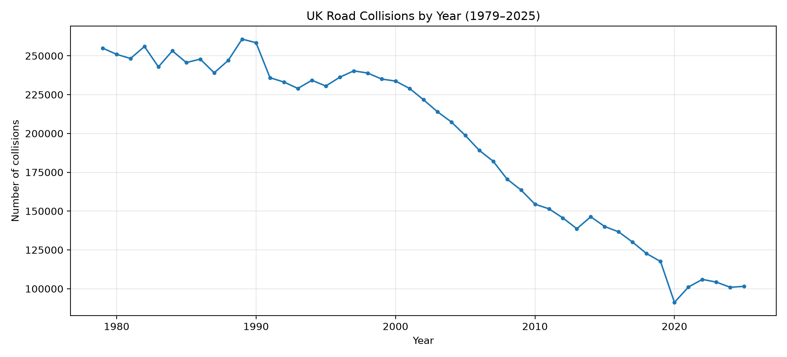

# Predicting Road Accident Severity in the UK

**DSAI3202 — Phase 1**  
**Student:** Abdulrahman Abuhashim  
**Student ID:** 60301190

## 1. Project and Hypothesis

My project aims to predict road accident severity in the UK using machine learning.

The target is `collision_severity`:
- 1 = Fatal
- 2 = Serious
- 3 = Slight

**Hypothesis:** Using road, weather, time, and location information, a machine-learning model can predict road accident severity better than a simple logistic regression model.

**Baseline model:** Logistic Regression  
**Comparison model:** Gradient-Boosted Trees  
**Evaluation metric:** Macro F1-score

Macro F1-score is chosen because the severity classes are imbalanced.

No changes to the hypothesis were documented during Phase 1. Model training will be done in the next phase.

## 2. Dataset and Architecture

### Dataset

- **Source:** UK Department for Transport
- **Dataset:** Road Safety Open Data — Collisions
- **Years:** 1979–2025
- **Format:** CSV
- **Size:** 1,534,937,928 bytes (approximately 1.53 GB)
- **Records:** 9,116,625
- **Columns:** 44
- **Ingestion:** Batch
- **Source version:** `source_v1`
- **Processed version:** `processed_v1`

Dataset link:  
https://www.gov.uk/government/statistical-data-sets/road-accidents-and-safety-statistics-data-tables

### Azure Architecture

```text
UK Department for Transport
           |
           v
      Original CSV
           |
           v
   Azure Blob Storage
     Raw Container
           |
           v
    Azure Linux VM
    Python ETL Pipeline
  Cleaning and Validation
           |
           v
    Processed Parquet
           |
           v
   Azure Blob Storage
   Processed Container
           |
      +----+----+
      |         |
      v         v
     EDA     Initial Features
```

Azure Blob Storage stores the datasets and metadata. The Azure VM runs the Python ETL, quality checks, EDA, and feature engineering.

### Storage Layout

**Storage account:** `amazonlake60301190`

Raw data:
`raw/projects/road-accident-severity/source_v1/`

Processed data:
`processed/projects/road-accident-severity/processed_v1/`

Metadata:
`processed/metadata/road_accident_metadata.json`

The original CSV is preserved in a versioned folder with a manifest containing its identity and SHA-256 hash.

The ingestion uses a fixed dataset snapshot. Future updates should use a new version.

A repeated upload with overwrite protection returned `BlobAlreadyExists`, confirming that the original file was not overwritten.

### Schema and Lineage

- [Schema — 44 columns](config/schema_v1.json)
- [Feature specification](config/features_v1.md)

**Primary key:** `collision_index`  
**Target:** `collision_severity`

Data lineage:

Original CSV → Azure raw storage → Python ETL → Azure processed Parquet files.

The Azure metadata JSON records the source, processing results, important fields, and lineage.

## 3. Run the Pipeline

### Prerequisites

- Ubuntu Linux
- Python 3.12
- Azure VM and Blob Storage access
- Azure Storage read/write permissions
- Original source CSV
- Required Python packages

### Dependencies

The dependencies are saved in [requirements.txt](requirements.txt).

```text
matplotlib==3.11.2
pandas==3.0.6
pyarrow==17.0.0
seaborn==0.13.2
```

### Setup

```bash
git clone https://github.com/AbdulrahmanAbuhashim/DSAI3202-Phase1.git
cd DSAI3202-Phase1
python3 -m venv .venv --system-site-packages
source .venv/bin/activate
python -m pip install -r requirements.txt
```

### Configuration and Execution

Configuration: `config/etl_config.json`

Main pipeline: `scripts/etl_pipeline.py`

Example command using the source path and run name:

```bash
python3 scripts/etl_pipeline.py \
  --input /path/to/source.csv \
  --run-name full_run_v1
```

The input path must be changed to the location of the CSV file. The arguments should be checked against the script before reproducing the run.

The ETL pipeline:

1. Reads CSV data in batches of 50,000.
2. Cleans and converts data types.
3. Checks missing and invalid values.
4. Detects duplicate identifiers.
5. Separates accepted and rejected records.
6. Applies the 1% rejection threshold.
7. Saves accepted records as Parquet files.

Publication is blocked when the rejection threshold is exceeded.

## 4. Results and Features

### ETL Results

**Run:** `full_run_v1`

**Local output:** `outputs/full_run_v1/`

**Azure output:** `processed/projects/road-accident-severity/processed_v1/`

| Metric | Result |
|---|---:|
| Input records | 9,116,625 |
| Accepted | 9,116,617 |
| Rejected | 8 |
| Duplicates | 0 |
| Parquet files | 183 |
| Quality gate | PASSED |

Row accounting: 9,116,617 + 8 = 9,116,625.

### Quality and Rerun Tests

| Test | Input | Accepted | Rejected | Result |
|---|---:|---:|---:|---|
| Normal test | 1,000 | 1,000 | 0 | Passed |
| Duplicate test | 1,005 | 1,000 | 5 | Passed |
| Quality failure | 100 | 95 | 5 | Publication blocked |

The controlled failure rejected 5% of records, exceeding the 1% threshold.

The safe ingestion rerun was tested using Azure overwrite protection.

### Exploratory Data Analysis

Four charts were generated using all 9,116,617 accepted records.

**Severity distribution:**

- Fatal: 146,175
- Serious: 1,676,556
- Slight: 7,293,886

Slight collisions are the most common. This class imbalance needs to be considered during model training.


The yearly trend analysis covers 1979–2025. Historical reporting differences may affect modeling.



Speed limit may be useful for predicting severity, but the observed relationship does not establish causation.


Weather categories were also examined. Unknown codes require appropriate handling.


**Correlation and outlier checks:**

A deterministic sample of 10,000 records was examined using the first 1,000 rows from each of the first ten Parquet files.

- Speed limit versus severity correlation: -0.119
- Missing values in four checked numerical columns: 0
- Speed limits outside 0–70 mph: 0
- Nonpositive vehicle or casualty counts: 0

The sample results may not represent the complete dataset.

**Evidence:**
- [EDA findings](evidence/eda/EDA_findings.md)
- [Numerical checks](evidence/eda/numeric_checks.txt)

The main data risks are class imbalance, missing geographical coordinates, unknown codes, and potential data leakage.

### Initial Feature Engineering

I created five features:

| Feature | Type | Source | Availability |
|---|---|---|---|
| hour | Numeric | time | If collision time is known |
| month | Numeric | date | If collision date is known |
| is_weekend | Binary | date | If collision date is known |
| is_night | Binary | time | If collision time is known |
| high_speed_road | Binary | speed_limit | If road information is known |

The features were tested successfully on 1,000 records.

Script: `scripts/feature_engineering.py`

[Versioned feature specification](config/features_v1.md)

Outcome-related variables such as `number_of_casualties` and adjusted severity fields are excluded from planned predictors to reduce leakage risk.

Feature selection was not performed in Phase 1.

## 5. Resource Use and Contributions

### Resource Use

I used an Azure Linux VM and Azure Blob Storage.

The ETL processes 50,000 records per batch rather than loading all 9.1 million records into memory.

SQLite was used for duplicate tracking across batches.

Approximately 19 GB of disk space was available on the VM's 29 GB filesystem at the recorded check.

Batch processing was selected to reduce memory requirements. Parquet was selected for efficient storage and column-based analysis.

A separate Azure billing-cost measurement was not performed.

### Cleanup

After verifying that the processed files are saved in Azure Storage, the VM can be stopped and deallocated to avoid unnecessary compute costs.

### Contributions

This is an individual project.

My work included data ingestion, Azure storage setup, ETL processing, quality testing, EDA, initial feature engineering, and project documentation.

### Reused Code

I applied data engineering approaches practiced in DSAI3202 labs, including batch processing, data cleaning, validation, and Parquet output.

The implementation was adapted for the UK collision dataset, its 44-column schema, and severity prediction task.

**Repository:**  
https://github.com/AbdulrahmanAbuhashim/DSAI3202-Phase1

**Branch:** `main`  
**Initial commit:** `e4d59cb`

Large datasets are stored in Azure, not GitHub.

## 6. AI Use

| Tool | Request | Response | My Changes |
|---|---|---|---|
| ChatGPT | Coding and ETL troubleshooting assistance | Suggested code and solutions | Executed and tested the scripts on Azure |
| ChatGPT | EDA and feature-engineering assistance | Suggested analysis and feature code | Generated outputs and checked results |
| ChatGPT | Documentation assistance | Suggested README content | Reviewed the documentation against project results |

---

## Phase 2: Modeling, Validation and Deployment

### 7. Model and Evaluation

The project predicts road accident severity using UK collision records. The target classes are:

- 1: Fatal
- 2: Serious
- 3: Slight

Two machine learning algorithms were compared:

- Logistic Regression as the baseline.
- Gradient-Boosted Trees as the candidate model.

The models use road, weather, lighting, location, and time features. Information that would only be known after an accident, such as the number of casualties, was excluded to avoid data leakage.

#### Training and Validation

A deterministic sample of approximately 5% was selected using collision IDs. The split was based on time:

| Dataset | Years | Records |
|---|---|---:|
| Training | 1979–2018 | 420,386 |
| Validation | 2019–2022 | 20,713 |
| Original test | 2023–2025 | 15,193 |

Missing values and categorical encoding were handled inside the model pipelines. Preprocessing was fitted using training data only.

#### Validation Results

| Model | Accuracy | Macro F1 |
|---|---:|---:|
| Logistic Regression | 0.6292 | 0.3055 |
| Original Gradient-Boosted Trees | 0.6204 | 0.3071 |
| Improved Gradient-Boosted Trees | 0.6279 | 0.3285 |

The improved Gradient-Boosted Trees model was selected because it achieved the highest validation macro F1.

The improvement experiment tested three configurations. The balanced configuration, using 100 boosting iterations and 31 maximum leaf nodes, performed best.

#### Hypothesis Outcome

The hypothesis required Gradient-Boosted Trees to improve macro F1 by at least 0.05 compared with Logistic Regression.

The improved candidate achieved 0.3285 compared with the baseline's 0.3055, a difference of 0.0230.

Therefore, the hypothesis was not supported by the validation results.

#### Evaluation Limitations

The original models were evaluated on the 2023–2025 test records before the improvement experiment. The original candidate achieved 0.3028 test macro F1, compared with 0.3019 for Logistic Regression.

Because the test results were already inspected before improving the candidate, this test set is not presented as an untouched final evaluation of the improved model.

The model also struggles to distinguish minority severity classes, especially Serious accidents. Its predictions should not be treated as reliable safety decisions.

#### Selected Model

- Algorithm: HistGradientBoostingClassifier
- Training source: Local Python environment
- Azure registered model: road-accident-severity
- Registered version: 1
- Data version: features_v1
- Random seed: 42
- Validation macro F1: 0.3285
- Model registration code commit: 0b787c22d81143f2d5d0e477fd85be792c40ac4e

The registered model includes its fitted preprocessing pipeline.


### 8. Traceability and Deployment

#### Model Traceability

The selected model is registered in Azure Machine Learning.

| Item | Value |
|---|---|
| Workspace | mlwdsai320260301190 |
| Resource group | rg-dsai3202-abdulrahman-60301190 |
| Region | Qatar Central |
| Registered model | road-accident-severity:1 |
| Feature version | features_v1 |
| Git commit at registration | 0b787c2 |
| Training source | Local Mac |
| Validation macro F1 | 0.3285 |

The registered model contains the trained classifier and fitted preprocessing pipeline. The training and improvement scripts are in the `scripts/` directory.

Python and dependency versions are recorded in `evidence/phase2/deployment/model_information.log`.

#### Deployment Configuration

The project uses an Azure Machine Learning managed online endpoint.

| Setting | Value |
|---|---|
| Endpoint | accident-severity-60301190 |
| Deployment | blue |
| Model | road-accident-severity:1 |
| VM size | Standard_DS3_v2 |
| Instance count | 1 |
| Authentication | Key |
| Traffic | 100% to blue |

Deployment files are located in `deployment/`:

- `score.py`: Loads the registered model and handles requests.
- `conda.yml`: Defines the Python environment.
- `endpoint.yml`: Defines the endpoint.
- `deployment.yml`: Defines the model deployment.
- `sample_request.json`: Example valid request.
- `invalid_request.json`: Example request with missing fields.

#### Repeatable Deployment Steps

The following commands recreate the endpoint and model deployment:

```bash
az ml online-endpoint create \
  --file deployment/endpoint.yml \
  --workspace-name mlwdsai320260301190 \
  --resource-group rg-dsai3202-abdulrahman-60301190

az ml online-deployment create \
  --file deployment/deployment.yml \
  --all-traffic \
  --workspace-name mlwdsai320260301190 \
  --resource-group rg-dsai3202-abdulrahman-60301190
```

Deployment requires access to the Azure workspace and sufficient VM quota.

#### Prediction Input and Output

The endpoint accepts JSON containing a `rows` list. Each row must contain all 16 model features.

Example request files are available in `deployment/`.

The response returns a `predictions` list and a `model_version` field.

Severity values:

- 1: Fatal
- 2: Serious
- 3: Slight

Requests with missing required fields return an error message. In the current implementation, validation errors are returned in JSON and are not guaranteed to use a non-200 HTTP status code.

### 9. Verification and Resource Use

#### Deployment Tests

The deployment was tested using Azure Machine Learning.

| Test | Result |
|---|---|
| Model registration | Passed |
| Endpoint creation | Passed |
| Deployment provisioning | Succeeded |
| Valid online prediction | Passed |
| Invalid request | Missing fields reported |
| Offline vs online comparison | 10/10 matching predictions |

The offline and online predictions matched exactly for the ten tested validation records.

#### Response Time

Five online requests were measured through Azure CLI.

| Request | Time |
|---|---:|
| 1 | 3.09 seconds |
| 2 | 2.43 seconds |
| 3 | 2.51 seconds |
| 4 | 2.42 seconds |
| 5 | 2.50 seconds |
| Average | 2.59 seconds |

These results include CLI startup and network overhead. They do not represent pure model inference latency.

#### Resource Use and Cleanup

The deployment used one Standard_DS3_v2 CPU instance.

This configuration was selected because the saved model is small and does not require GPU inference. The managed endpoint was deleted after testing to avoid unnecessary running costs.

The registered Azure model was retained for future deployment. Cleanup evidence is saved in:

`evidence/phase2/deployment/cleanup_verification.log`

#### Supporting Evidence

Training, validation, ETL, feature engineering, registration, deployment, testing, and cleanup evidence are organized under:

`evidence/phase2/`


### 10. Contributions and Reused Code

This is an individual project. I managed the Phase 2 work, including data processing, model development, evaluation, Azure deployment, testing, and documentation.

The implementation uses approaches covered in DSAI3202 labs, adapted to the UK road accident severity dataset.

### 11. Phase 2 AI Use

I managed the project and made the final technical decisions. ChatGPT supported the development process through code suggestions, troubleshooting, and documentation assistance. I executed the scripts, reviewed the outputs, and verified the results.

| Tool | Request | Response | My Changes |
|---|---|---|---|
| ChatGPT | ETL and data preparation assistance | Suggested Python changes and validation checks | Applied the changes and tested data quality |
| ChatGPT | Model development assistance | Suggested training, evaluation, and improvement scripts | Ran the experiments, compared metrics, and selected the model |
| ChatGPT | Azure deployment guidance | Suggested CLI commands and configuration files | Registered, deployed, and tested the model in Azure |
| ChatGPT | Documentation support | Suggested README content and structure | Reviewed and checked the documentation against recorded results |

All reported model results and deployment outcomes were obtained from executed experiments and Azure operations.


### 12. Dataset Reproducibility

The exact sampled datasets used for modeling are stored in Azure Blob Storage.

- Storage account: `amazonlake60301190`
- Container: `curated`
- Dataset folder: `projects/road-accident-severity/model_data_v1/`

| Dataset | Azure blob |
|---|---|
| Training | `train.parquet` |
| Validation | `validation.parquet` |
| Test | `test.parquet` |

These are paths relative to the dataset folder above.

The datasets were generated using `scripts/prepare_training_data.py` from the `features_v1` feature dataset. Sampling selects collision IDs whose pandas hash is divisible by 20, producing approximately 5% of records.

The exact dataset file sizes and SHA-256 checksums are saved in:

`evidence/phase2/training/dataset_manifest.json`

Azure upload and verification outputs are saved in:

- `evidence/phase2/training/dataset_upload.log`
- `evidence/phase2/training/dataset_verification.log`

The Azure files have matching sizes. Their exact contents can be checked against the SHA-256 manifest after download.

### 13. Additional Model Experiment: Extra Trees

After evaluating Gradient-Boosted Trees, I tested Extra Trees to improve accident severity prediction, particularly for Serious accidents.

#### Validation Comparison

| Metric | Gradient Boosting (v1) | Extra Trees (v2) |
|---|---:|---:|
| Accuracy | 0.6279 | 0.6750 |
| Macro F1 | 0.3285 | 0.3660 |
| Fatal F1 | 0.0778 | 0.0717 |
| Serious F1 | 0.1152 | 0.2226 |

Extra Trees achieved better validation accuracy and macro F1, and substantially improved Serious F1. However, Fatal F1 remained very low and was slightly worse than Gradient Boosting.

Extra Trees was selected as the final deployed model based on validation macro F1. This additional experiment does not change the original Gradient-Boosting hypothesis outcome, which was not supported.

#### Model Configuration

- Algorithm: ExtraTreesClassifier
- Trees: 150
- Minimum samples per leaf: 5
- Maximum features: 0.8
- Class weighting: balanced
- Random seed: 42
- Training records: 420,386
- Validation records: 20,713
- Feature dataset: features_v1

The model uses 20 input features and includes fitted preprocessing.

#### Model Size and Compression

The original Extra Trees model was approximately 1,185.6 MB. After joblib compression, the saved file was approximately 362.9 MB.

Predictions from the compressed and original models matched for all 20,713 validation records. Compression did not change validation accuracy or macro F1.

#### Azure Deployment Version 2

The model was registered in Azure Machine Learning as `road-accident-severity:2`.

The managed endpoint used:

- Endpoint: `accident-severity-60301190`
- Deployment: `green`
- Compute: one Standard_DS3_v2 CPU instance
- Scoring script: `deployment/score_v2.py`
- Deployment configuration: `deployment/deployment_v2.yml`

Online testing confirmed:

| Test | Result |
|---|---|
| Valid prediction | Passed |
| Invalid request | Missing fields reported |
| Offline/online consistency | 10/10 matching predictions |
| Average Azure CLI request time | 2.35 seconds |
| Endpoint cleanup | Completed |

The recorded latency includes Azure CLI and network overhead. It is not pure model inference latency.

The endpoint was deleted after testing to avoid ongoing compute charges. Model versions 1 and 2 remain registered in Azure.

#### Limitations

The Extra Trees results are based on validation data. The previously inspected 2023–2025 test set was not used to report a new untouched final test result.

Fatal accident prediction remains weak. The model is an academic prototype and should not be relied on for real-world road safety decisions.

#### Evidence

- `evidence/phase2/training/extra_trees_test.log`
- `evidence/phase2/training/extra_trees_metrics.json`
- `evidence/phase2/deployment/extra_trees_registration.log`
- `evidence/phase2/deployment/deployment_v2_creation.log`
- `evidence/phase2/deployment/prediction_comparison_v2.log`
- `evidence/phase2/deployment/latency_v2.log`
- `evidence/phase2/deployment/cleanup_v2.log`
